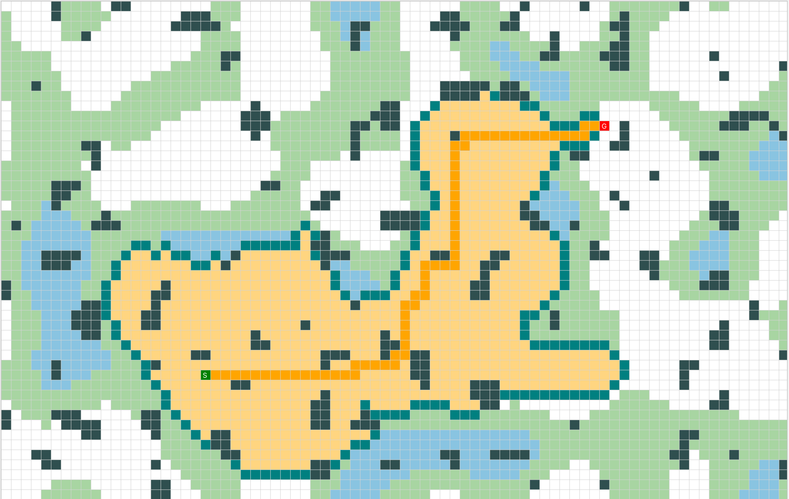

# Pathfinder



Pathfinder è un ambiente per visualizzare e confrontare le principali strategie di ricerca su griglia 2D. Si parte da scenari semplici, con costi di attraversamento uniformi, fino a mappe con terreni diversi (erba e acqua) che hanno costi di percorrenza differenti. La ricerca viene mostrata in tempo reale nell'interfaccia grafica, e uno script di benchmark confronta gli algoritmi su mappe di varie dimensioni.

## Algoritmi implementati

**Ricerca non informata:** BFS, DFS, Uniform Cost Search (UCS), IDDFS, Ricerca Bidirezionale

**Ricerca informata:** Greedy Best-First, A* con euristica di Manhattan, A* con euristica Euclidea, IDA*

**Ricerca locale:** Hill Climbing

## Ambiente di simulazione

L'agente si muove in una griglia N × M in quattro direzioni (Nord, Sud, Est, Ovest) e deve trovare il percorso meno oneroso da una cella di partenza a una di arrivo. L'ambiente è completamente osservabile, deterministico, statico e con un solo agente.

Costi di attraversamento:

- Strada (bianco): 1
- Erba (verde chiaro): 3
- Acqua (azzurro): 8
- Muri (nero): invalicabili

Convenzione dei colori nella visualizzazione:

- Nodo di partenza: verde
- Nodo di destinazione: rosso
- Frontiera: verde scuro
- Nodi espansi: arancione chiaro
- Percorso finale: arancione scuro

Le mappe vengono generate con Perlin Noise, così muri e terreni formano barriere, corridoi e regioni coerenti invece di celle sparse. Il generatore verifica con una BFS che almeno il 40% della mappa sia raggiungibile.

## Requisiti

- JDK 17
- Apache Maven 3.x
- JavaFX 21.0.2

## Installazione

```
git clone https://github.com/raf-parisi/pathfinder.git
cd pathfinder
mvn clean install
```

Il progetto è composto da due moduli Maven: `core` (algoritmi, ambiente e benchmark) e `gui` (interfaccia JavaFX). Esegui sempre `mvn clean install` prima dei comandi qui sotto, altrimenti il modulo `gui` non trova `core`.

## Utilizzo

**Interfaccia grafica**

```
mvn -pl gui javafx:run
```

**Benchmark**

```
mvn -pl core exec:java -Dexec.mainClass="pathfinder.algorithms.AlgorithmComparisonTest"
```

Il benchmark esegue tutti gli algoritmi su griglie 10 × 10, 20 × 20 e 50 × 80, con 50 mappe indipendenti e 5 coppie start/goal per mappa (250 test per scenario). IDDFS e IDA* hanno un timeout di 200 ms. Gli scenari sono tre:

- **A:** solo strada, senza muri
- **B:** strada con muri fitti (40%)
- **C:** terreni variabili (strada, erba, acqua) con muri fitti (40%)

Per ogni algoritmo vengono stampati nodi espansi, memoria massima, tempo, tasso di successo, percentuale di soluzioni ottime e overhead medio sulle soluzioni sub-ottime.
